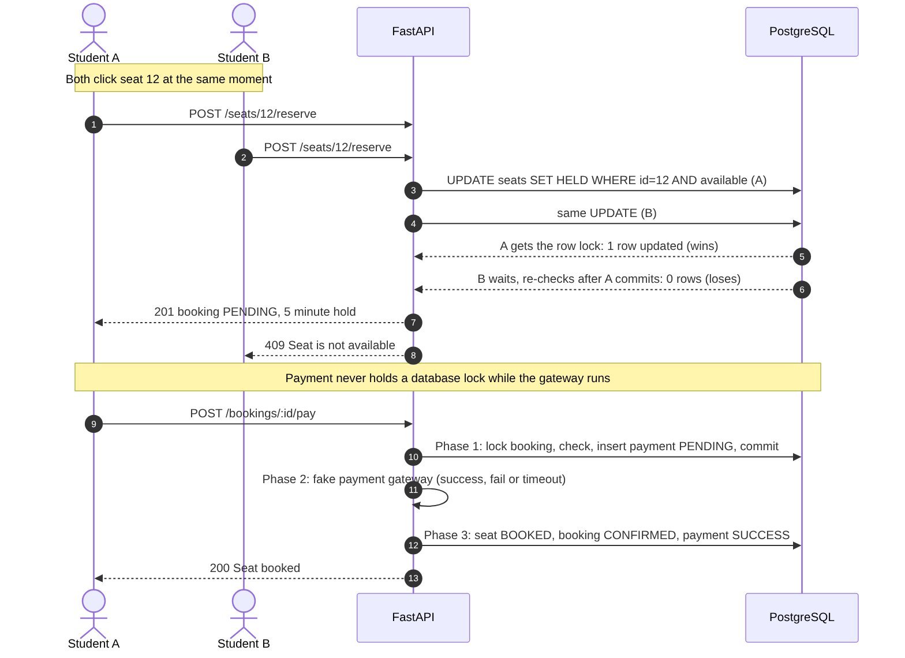
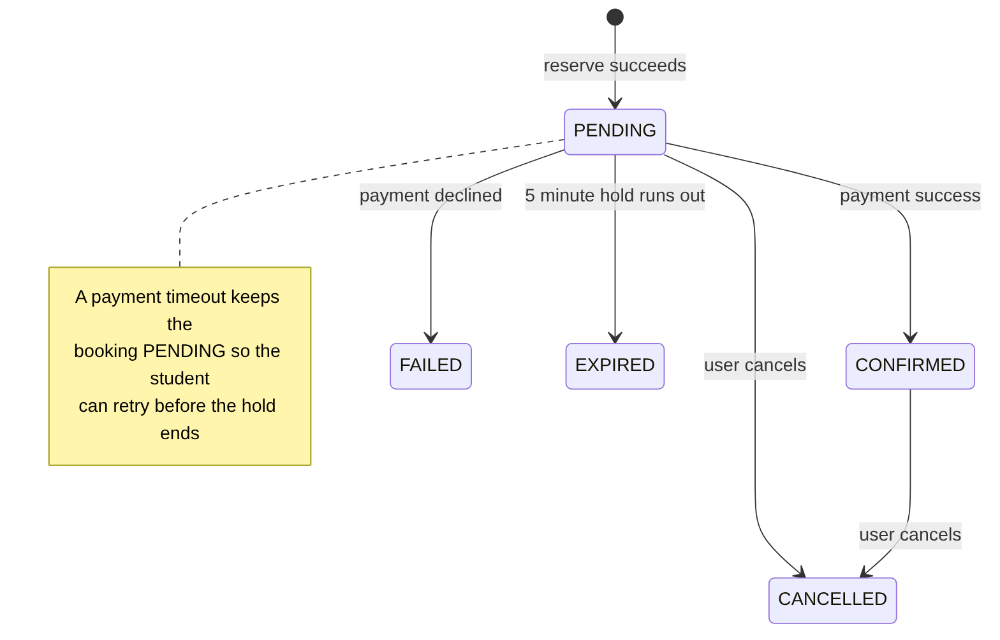
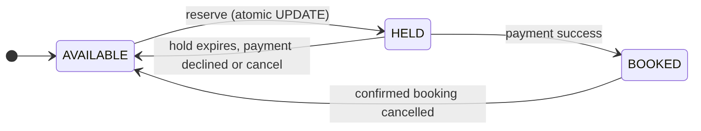

# The Last Seat

A ticket-booking backend for a college concert with **500 seats** and thousands of students trying to book at once. It guarantees that **no seat is ever booked twice**, even under heavy concurrent load.

Students can view seats, reserve one for 5 minutes, pay (simulated), and cancel. Unpaid reservations expire automatically and the seat goes back on sale.

**Stack:** Python, FastAPI, PostgreSQL 16, Docker (database), Locust (load testing)

---

## Features

| Requirement | How it is met |
|---|---|
| View available seats, reserve, confirm | `GET /seats`, `POST /seats/{id}/reserve`, `POST /bookings/{id}/pay` |
| No double booking | One atomic SQL `UPDATE` claims a seat; a unique index backs it up |
| Temporary reservations that expire | 5-minute hold; lazy expiry in queries plus a background sweeper |
| Cancellation and seat reallocation | `POST /bookings/{id}/cancel` frees the seat for the next student |
| Payment simulation: success, failed, delayed | Fake gateway: 70% success, 20% declined, 10% timeout, with random delays |
| Consistent under repeated or concurrent requests | Transactions, row locks and `Idempotency-Key` support |
| Booking history and reservation status | `GET /users/{id}/bookings`, `GET /bookings/{id}` |
| Bonus: idempotency keys | Supported on reserve and pay |

## How it prevents double booking

Reserving a seat is a single SQL statement that checks and claims in one step:

```sql
UPDATE seats
SET status = 'HELD', held_by = :user, held_until = now() + make_interval(mins => :hold)
WHERE id = :seat
  AND (status = 'AVAILABLE' OR (status = 'HELD' AND held_until < now()))
RETURNING id;
```

If two students request the same seat at the same instant, PostgreSQL locks the row for the first one. The second `UPDATE` waits, then re-checks the condition, finds the seat taken and changes **0 rows**. The API answers `409 Seat is not available`. The decision is made by the database, so it stays correct with many server processes.



Full explanation: [docs/CONCURRENCY_AND_SCALING.md](docs/CONCURRENCY_AND_SCALING.md)

## Project structure

```
app/
  main.py         API endpoints, payment simulation, idempotency
  db.py           database connection pool
  sweeper.py      background job that expires old reservations
db/
  schema.sql      tables, constraints, and the 500 seeded seats
  reset.sql       wipes test data and frees every seat
  verify.sql      consistency checks to run after load tests
loadtest/
  locustfile.py   Locust test: simulated students booking seats
docs/             ERD, diagrams, concurrency and scaling document
docker-compose.yml   PostgreSQL container
requirements.txt     runtime dependencies
requirements-dev.txt load-testing dependencies (Locust)
```

## Getting started

**Requirements:** Python 3.10+, Docker Desktop, Git.

```bash
git clone <your-repo-url>
cd The-Last-Seat

# 1. Python environment
python -m venv .venv
# Windows PowerShell:   .venv\Scripts\Activate.ps1
# macOS / Linux:        source .venv/bin/activate
pip install -r requirements.txt

# 2. Start PostgreSQL in Docker
docker compose up -d
```

Create the tables and seed the 500 seats (first time only):

```powershell
# Windows PowerShell
Get-Content db/schema.sql | docker exec -i lastseat_db psql -U seatuser -d seatdb
```
```bash
# macOS / Linux
docker exec -i lastseat_db psql -U seatuser -d seatdb < db/schema.sql
```

Start the API:

```bash
uvicorn app.main:app
```

Open **http://127.0.0.1:8000/docs** for the interactive API documentation, where every endpoint can be tried in the browser.

**Settings** (environment variables, both optional):

| Variable | Default | Meaning |
|---|---|---|
| `HOLD_MINUTES` | `5` | How long a reservation is held before it expires |
| `PAYMENT_MAX_DELAY` | `3` | Maximum seconds the fake payment gateway takes |

Database credentials are in `docker-compose.yml` (`seatuser` / `seatpass` / `seatdb`). They are for local development only.

## API reference

Interactive docs: `http://127.0.0.1:8000/docs`

| Method | Endpoint | Description |
|---|---|---|
| `GET` | `/` | Health check |
| `POST` | `/users` | Create a user (returns the existing user if the email is already registered) |
| `GET` | `/seats?available_only=true` | List seats with their current status |
| `POST` | `/seats/{seat_id}/reserve` | Reserve a seat for 5 minutes |
| `POST` | `/bookings/{booking_id}/pay` | Pay for a booking (simulated) |
| `POST` | `/bookings/{booking_id}/cancel` | Cancel a booking and free the seat |
| `GET` | `/bookings/{booking_id}` | Reservation status |
| `GET` | `/users/{user_id}/bookings?status=CONFIRMED` | Booking history, newest first, with an optional status filter |

`reserve` and `pay` also accept an optional `Idempotency-Key` header.

### Example requests

> On Windows PowerShell, use `curl.exe` instead of `curl` (plain `curl` is an alias for a different command), or simply try the endpoints in the browser at `/docs`.

**Create a user**
```bash
curl -X POST http://127.0.0.1:8000/users \
  -H "Content-Type: application/json" \
  -d '{"name": "Asha", "email": "asha@college.test"}'
```
```json
{"id": 1, "name": "Asha", "email": "asha@college.test"}
```

**List available seats**
```bash
curl "http://127.0.0.1:8000/seats?available_only=true"
```
```json
{"count": 500, "seats": [{"id": 1, "seat_number": "S001", "status": "AVAILABLE"}, "..."]}
```

**Reserve a seat**
```bash
curl -X POST http://127.0.0.1:8000/seats/1/reserve \
  -H "Content-Type: application/json" \
  -H "Idempotency-Key: asha-seat1-001" \
  -d '{"user_id": 1}'
```
```json
{
  "booking": {"id": 1, "user_id": 1, "seat_id": 1, "status": "PENDING",
              "expires_at": "2026-10-15T18:30:00+00:00"},
  "seat_number": "S001"
}
```

If the seat is taken, the answer is `409`:
```json
{"detail": "Seat is not available"}
```

**Pay for the booking**

Leave the body empty for a random outcome, or force one for testing with `"outcome": "success"`, `"fail"` or `"timeout"`.
```bash
curl -X POST http://127.0.0.1:8000/bookings/1/pay \
  -H "Content-Type: application/json" \
  -d '{"outcome": "success"}'
```
```json
{"payment_id": 1, "outcome": "success", "booking_status": "CONFIRMED", "message": "Seat booked!"}
```

| Outcome | Booking status | What happens |
|---|---|---|
| `success` | `CONFIRMED` | Seat becomes `BOOKED` |
| `fail` | `FAILED` | Payment declined, seat released for others |
| `timeout` | stays `PENDING` | The student can retry before the hold expires |

**Check status and history**
```bash
curl http://127.0.0.1:8000/bookings/1
curl "http://127.0.0.1:8000/users/1/bookings?status=CONFIRMED"
```

**Cancel**
```bash
curl -X POST http://127.0.0.1:8000/bookings/1/cancel
```
```json
{"booking_id": 1, "status": "CANCELLED", "message": "Seat is available again"}
```

### Idempotency

Sending the same `Idempotency-Key` again returns the **saved** answer with the header `Idempotent-Replay: true` instead of creating a second booking or payment. Reusing a key for a different request returns `422`, and repeating it while the first request is still running returns `409`.

### Status codes

| Code | Meaning |
|---|---|
| `201` | Reservation or user created |
| `200` | Success |
| `404` | User, seat or booking not found |
| `409` | Seat not available, booking not in the right state, reservation expired, or payment already in progress |
| `422` | Invalid input, or `Idempotency-Key` reused for a different request |

## Database

PostgreSQL with five tables: `users`, `seats`, `bookings`, `payments` and `idempotency_keys`.


Details and constraints: [docs/ERD.md](docs/ERD.md)

## Booking lifecycle





## Load testing

The test simulates students who each create an account, try random seats until a reserve succeeds, then pay or abandon the booking (15% abandon). A `409` on reserve counts as a correct answer, not a failure.

```bash
pip install -r requirements-dev.txt

# 1. wipe old test data
#    PowerShell: Get-Content db/reset.sql | docker exec -i lastseat_db psql -U seatuser -d seatdb
#    bash:       docker exec -i lastseat_db psql -U seatuser -d seatdb < db/reset.sql

# 2. start the API with faster fake payments (no --reload)
#    PowerShell: $env:PAYMENT_MAX_DELAY="0.3"; uvicorn app.main:app
#    bash:       PAYMENT_MAX_DELAY=0.3 uvicorn app.main:app

# 3. start Locust, then open http://localhost:8089
locust -f loadtest/locustfile.py --host http://127.0.0.1:8000

# 4. after pressing Stop, check the data
#    PowerShell: Get-Content db/verify.sql | docker exec -i lastseat_db psql -U seatuser -d seatdb
#    bash:       docker exec -i lastseat_db psql -U seatuser -d seatdb < db/verify.sql
```

`db/verify.sql` proves correctness: no seat with more than one active or confirmed booking, no booking charged twice, and confirmed bookings equal booked seats.

### Results

1000 virtual students, spawn rate 100 per second, 500 seats. Run on a single laptop with one API process, PostgreSQL in Docker, and Locust on the same machine.

| Measure | Result |
|---|---|
| Reserve requests | 13,620, with 0 server errors |
| Pay requests | 559, with 0 server errors |
| Bookings created | 616: 390 confirmed, 116 failed payments, 110 unfinished or abandoned |
| Reserve requests rejected with `409` | about 13,000 |
| Seats booked more than once | **0** |
| Bookings charged more than once | **0** |
| Confirmed bookings vs booked seats | 390 = 390 |
| 5 minutes after the test | all 110 unfinished holds expired and their seats were `AVAILABLE` again |


**Limitation:** during the initial burst, 19% of the sign-up requests (`POST /users`) failed or were slow (up to 16 s). This marks the ceiling of a single API process on one laptop and does not affect booking correctness. The scaling plan below addresses it.

## Scaling

The API keeps no state in memory, so it can run as many copies behind a load balancer. The seat-claiming `UPDATE` only serialises requests for the same seat, so adding servers does not risk double booking. Planned improvements, in order of impact:

1. Several worker processes behind an **nginx** reverse proxy, and a tuned connection pool (or PgBouncer).
2. **Redis** for caching the seat list and a "sold out" flag, so doomed requests never reach the database.
3. A **message queue** (RabbitMQ, Kafka or NATS) for payment processing.
4. A **waiting queue** that offers freed seats to waiting students in order.

Details: [docs/CONCURRENCY_AND_SCALING.md](docs/CONCURRENCY_AND_SCALING.md)

## Known limitations

- No authentication: the user id is sent in the request body.
- Payments are simulated and there is no refund state.
- Redis, a message queue, a waiting queue and a reverse proxy are not implemented yet.
- The API is not yet containerised; only PostgreSQL runs in Docker.

The full list, with fixes, is in the [concurrency document](docs/CONCURRENCY_AND_SCALING.md#9-known-limitations).

## Documentation

- [Concurrency handling and scaling](docs/CONCURRENCY_AND_SCALING.md)
- [Database design (ERD)](docs/ERD.md)
- Interactive API docs at `/docs` while the server is running
