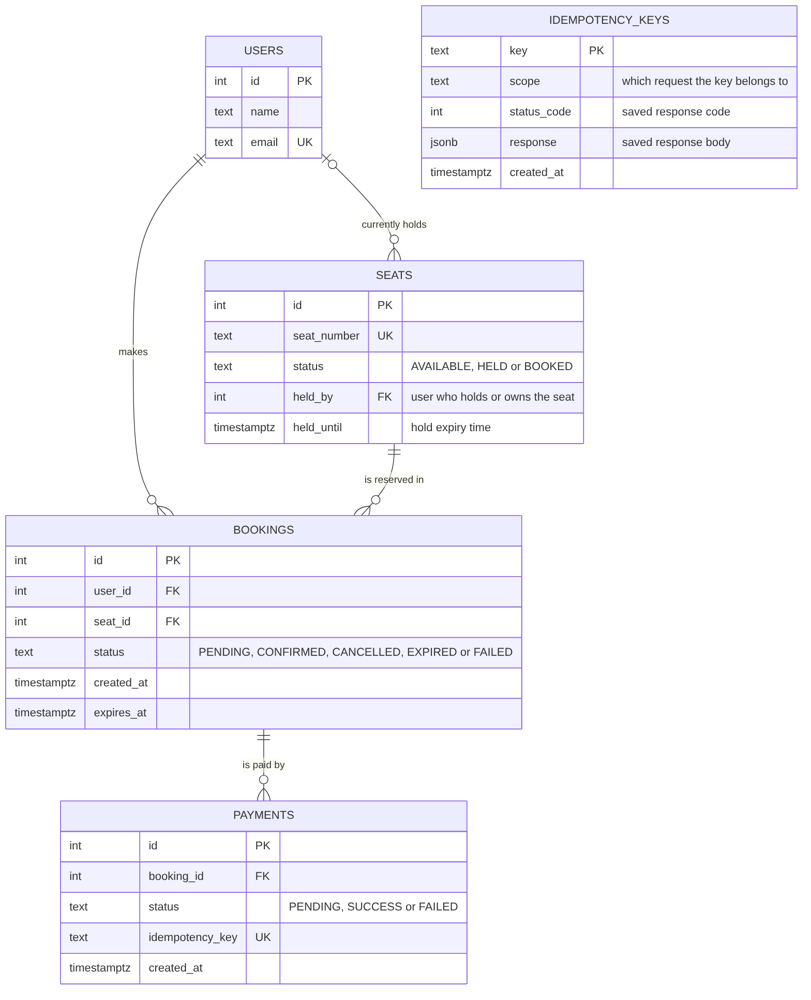

# Database Design (ERD)

PostgreSQL schema from `db/schema.sql`.

## Tables

| Table | Purpose | Key columns |
|---|---|---|
| `users` | Students who book tickets | `email` is unique, so creating the same user twice returns the existing one |
| `seats` | The 500 physical seats. **This row is what students compete for** | `status` is `AVAILABLE`, `HELD` or `BOOKED`; `held_by` and `held_until` say who holds the seat and until when |
| `bookings` | History of every reservation that grabbed a seat | `status` is `PENDING`, `CONFIRMED`, `CANCELLED`, `EXPIRED` or `FAILED`; `expires_at` is when the hold ends |
| `payments` | Every payment attempt for a booking | `status` is `PENDING`, `SUCCESS` or `FAILED`; one booking can have several attempts |
| `idempotency_keys` | Saved answers for repeated requests | `key` is the primary key; `status_code` and `response` store the first answer so it can be replayed |

## Relationships

- A **user** makes many **bookings**; each booking belongs to one user.
- A **seat** appears in many **bookings** over time (for example, expired or cancelled ones), but only one can be active at once (see below).
- A **booking** can have many **payments** (a declined payment can be retried).
- A **seat** is currently held or owned by at most one **user** (`seats.held_by`).
- `idempotency_keys` has no foreign key. It links to requests through its `scope` text (for example `reserve:12:5` or `pay:40`).

## Rules enforced by the database itself

| Rule | How |
|---|---|
| Seat status can only be one of three values | `CHECK` constraint on `seats.status` |
| Booking and payment statuses are limited to known values | `CHECK` constraints on `bookings.status` and `payments.status` |
| **A seat can have only one active booking** | Partial unique index `one_active_booking_per_seat` on `bookings (seat_id)` where status is `PENDING` or `CONFIRMED` |
| No duplicate emails or seat numbers | `UNIQUE` on `users.email` and `seats.seat_number` |
| No booking without a real user and seat | Foreign keys |
| An idempotency key can be claimed only once | Primary key on `idempotency_keys.key` |

The partial unique index is a second line of defence: even if application code had a bug, PostgreSQL would refuse to create a second active booking for the same seat.
